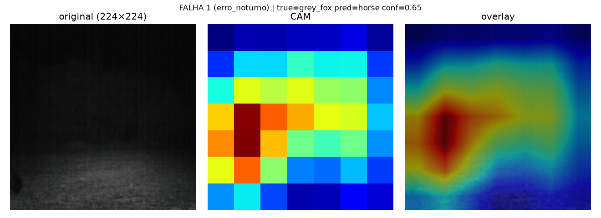
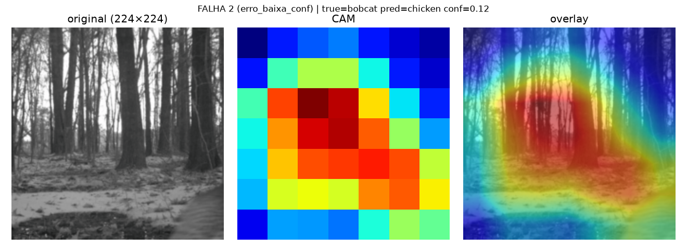
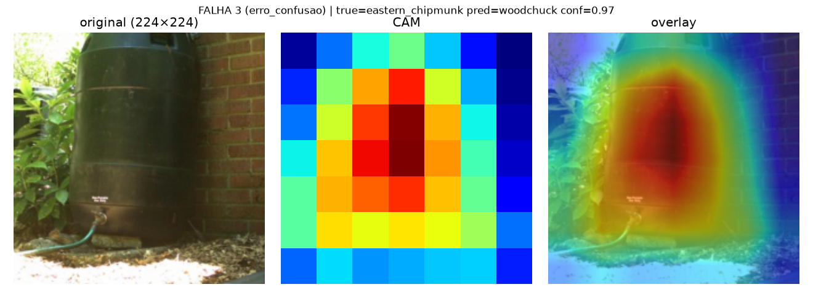
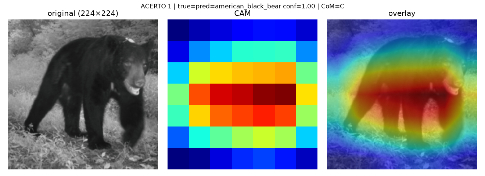
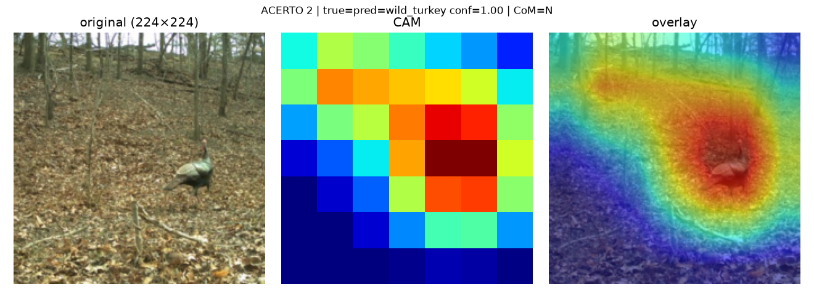
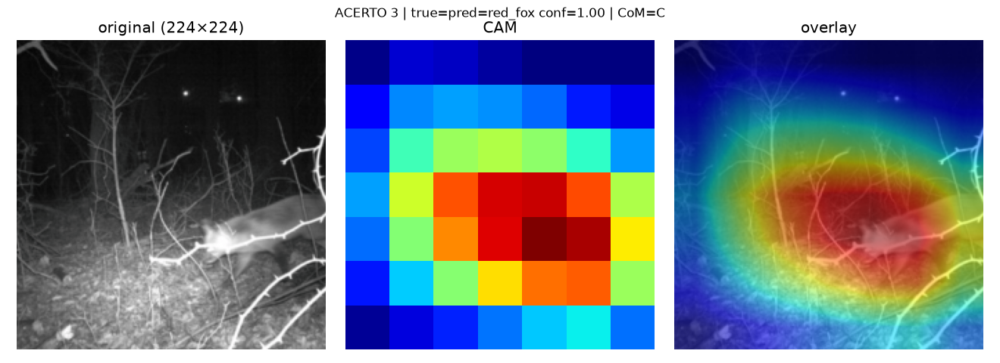
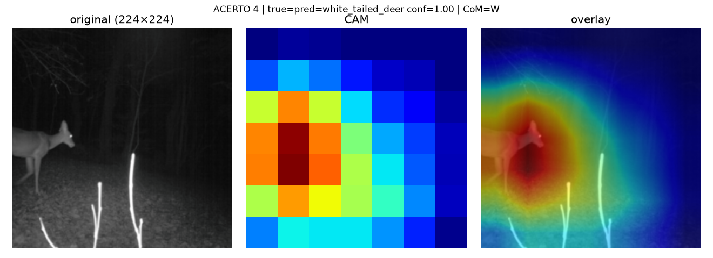
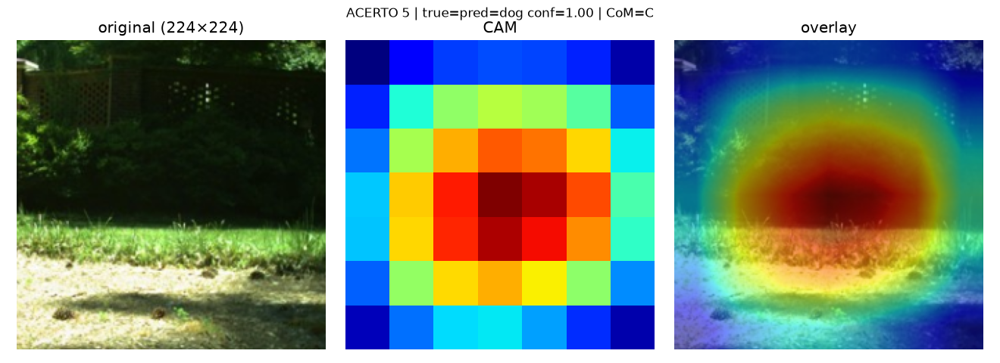

# Galeria de falhas e atalhos — `student_perclass_resnet18_b5_s2`

- backbone: `resnet18`
- pseudo: `runs/teacher_bioclip2/train_pseudo.pt`
- noise: `perclass`  mode: `hard`
- budget: 5  seed: 2
- test_public: 0.5948786512962493 F1 macro

## Falhas (3)

### Falha 1 — `36f1e6f7ceb69e36` (erro_noturno)

- **Verdadeira:** `grey_fox`
- **Prevista:** `horse`  (confiança 0.65)
- **Diagnóstico automático:** Erro noturno (brightness=21/255, mediana do test=126). CAM com CoM na célula C (com_y=3, com_x=3); focused_area=69%, entropia=0.93. Atenção difusa (o modelo não tem uma região dominante).

### Falha 2 — `b359e4b97f74a9cd` (erro_baixa_conf)

- **Verdadeira:** `bobcat`
- **Prevista:** `chicken`  (confiança 0.12)
- **Diagnóstico automático:** Confiança baixa (max_prob=0.12). CAM com CoM na célula C (com_y=3, com_x=3); focused_area=80%, entropia=0.95. Atenção difusa (o modelo não tem uma região dominante).

### Falha 3 — `85c1af8b5c3b799e` (erro_confusao)

- **Verdadeira:** `eastern_chipmunk`
- **Prevista:** `woodchuck`  (confiança 0.97)
- **Diagnóstico automático:** Confusão comum: eastern_chipmunk → woodchuck (par frequente na matriz do professor). Esse par também é confundido pelo professor. CAM com CoM na célula C (com_y=3, com_x=3); focused_area=82%, entropia=0.95. Atenção difusa (o modelo não tem uma região dominante).

## Acertos (5)

### Acerto 1 — `61865be1cf1c2d24`

- **Classe (verdadeira = prevista):** `american_black_bear`  (confiança 1.00)
- **CoM da CAM:** célula `C`  (focused_area=69%, entropia=0.93)
- **Hipótese:** atenção difusa — inconclusivo visualmente.

### Acerto 2 — `ac2de5f9675331d1`

- **Classe (verdadeira = prevista):** `wild_turkey`  (confiança 1.00)
- **CoM da CAM:** célula `N`  (focused_area=71%, entropia=0.91)
- **Hipótese:** atenção difusa — inconclusivo visualmente.

### Acerto 3 — `969b053c0d7fdba1`

- **Classe (verdadeira = prevista):** `red_fox`  (confiança 1.00)
- **CoM da CAM:** célula `C`  (focused_area=69%, entropia=0.92)
- **Hipótese:** atenção difusa — inconclusivo visualmente.

### Acerto 4 — `33c46639f0c553c6`

- **Classe (verdadeira = prevista):** `white_tailed_deer`  (confiança 1.00)
- **CoM da CAM:** célula `W`  (focused_area=59%, entropia=0.89)
- **Hipótese:** atenção difusa — inconclusivo visualmente.

### Acerto 5 — `ae56d88477ae74ab`

- **Classe (verdadeira = prevista):** `dog`  (confiança 1.00)
- **CoM da CAM:** célula `C`  (focused_area=80%, entropia=0.95)
- **Hipótese:** atenção difusa — inconclusivo visualmente.

## Open-set (pergunta da apresentação)

Sinais de "imagem fora das 21 classes": `max_prob` baixo, `entropia` alta, `margin` baixo. Ver `open_set_signal.csv` e `open_set_signal.png`.

- p95 de `max_prob` no test_public: **0.999**
- p05 de `max_prob` no test_public: **0.309**
- p05 de `margin`: **0.046**

**Sugestão para a apresentação:** uma imagem nova com `max_prob < p05` **e** `margin < p05` seria sinalizada como "fora das 21 classes". O aluno sozinho tem esse sinal fraco; um segundo sinal vem do **professor** (BioCLIP 2): se o teacher também estiver com confiança baixa **e** discordar do aluno, é duplo indício. Em produção: rejeitar a predição ou marcar como `unknown` para revisão humana.
